# CareKin Entity Relationship Diagram

Data model for the CareKin FastAPI backend: **34 tables across 10 domains**. Derived from the PRD (section 10.3 key models plus the functional requirements in section 7) and the endpoints in the Engineering Kickoff and the daily build plan.

The PRD names 14 key models. The other 20 tables are what the endpoints and rules need in order to work: guarantors and verification checks for vetting (TS-1), payments, escrow and a ledger for BK-2 and BK-6, crisis alerts per recipient (CR-1), passport shares tied to consent (HP-3), and conversation logs for the agents (PRD 8.1).

A PNG of the full diagram is in `CareKin_ERD.png`.

## Contents

1. [Conventions](#conventions)
2. [Overview diagram](#1-overview)
3. [Domain diagrams](#2-domain-diagrams)
4. [Migration order](#3-migration-order)
5. [User references not drawn](#4-user-references-not-drawn)
6. [Enums](#5-enums)
7. [Constraints and indexes](#6-constraints-and-indexes)
8. [How the schema enforces PRD rules](#7-how-the-schema-enforces-prd-rules)
9. [Open decisions that change the schema](#8-open-decisions-that-change-the-schema)

## Conventions

- **Primary keys** are `uuid` (`gen_random_uuid()`), except the append-only `ledger_entries` and `audit_logs`, which use `bigint` identity.
- **Timestamps** are `timestamptz` stored in UTC.
- **Money** is an integer in minor units (`*_minor`, kobo or cents) plus an ISO currency code. Never floats.
- **`geography_point`** means `geography(Point, 4326)` with a GIST index (PostGIS).
- **`encrypted_text`** means a column encrypted by `core/encryption.py` (stored as `bytea`). Encrypted columns can't be filtered or sorted in SQL.
- **`text_array`** means `text[]`. Every other non-standard type is a Postgres enum, listed in [Enums](#5-enums).
- **Cardinality** uses crow's foot notation: `||` exactly one, `o|` zero or one, `o{` zero or many, `|{` one or many.
- **Starter repo tables.** PRD 10.2 says the shared starter repo provides users, audit log, payments and the agent toolkit. Tables marked *starter repo* below should be matched against that repo's tables rather than created twice.
- **P1 tables** (`FamilyLink`, `CareNote`) can wait until the pilot window.

| Domain | Tables | Lives in |
| --- | --- | --- |
| Auth and consent | `User`, `RefreshToken`, `ConsentRecord` | `app/domains/auth/models.py` |
| Patients | `Patient`, `Guardian`, `EmergencyContact`, `CareProfile`, `FamilyLink` | `app/domains/patients/models.py` |
| Caregivers | `Caregiver`, `Guarantor`, `Certification`, `VerificationCheck`, `AvailabilityWindow` | `app/domains/caregivers/models.py` |
| Facilities | `Facility`, `FacilityService` | `app/domains/facilities/models.py` |
| Bookings | `Booking`, `GuardianApproval`, `Shift`, `CheckIn`, `Review`, `CareNote` | `app/domains/bookings/models.py` |
| Payments and escrow | `Payment`, `EscrowTransaction`, `LedgerEntry`, `WebhookEvent` | `app/domains/payments/models.py (new domain)` |
| Crisis | `CrisisEvent`, `CrisisAlert` | `app/domains/crisis/models.py` |
| Health passport | `PassportEntry`, `PassportShare` | `app/domains/passport/models.py` |
| Trust and safety | `Incident`, `AuditLog` | `app/domains/trust/models.py; AuditLog in app/core/audit.py` |
| AI agents | `AgentConversation`, `AgentMessage`, `Reminder` | `app/agents/models.py (new file)` |

## 1. Overview

Every table and every relationship, without columns. Columns that only record which user did something (`created_by`, `approved_by` and similar) are left off the diagrams to keep them readable; they're listed in [section 4](#4-user-references-not-drawn).

```mermaid
erDiagram
    User ||--o{ RefreshToken : "holds"
    User ||--o{ ConsentRecord : "gives"
    Patient |o--o{ ConsentRecord : "covered by"
    User |o--o| Patient : "is"
    User ||--o{ Guardian : "acts as"
    Patient ||--o{ Guardian : "has"
    Patient ||--o{ EmergencyContact : "has"
    Patient ||--o| CareProfile : "has"
    Facility |o--o{ CareProfile : "primary for"
    Patient ||--o{ FamilyLink : "shares with"
    User ||--o{ FamilyLink : "follows"
    User ||--o| Caregiver : "is"
    Caregiver ||--|{ Guarantor : "named"
    Caregiver ||--o{ Certification : "holds"
    Caregiver ||--o{ VerificationCheck : "undergoes"
    Caregiver ||--o{ AvailabilityWindow : "sets"
    User |o--o{ Facility : "claims"
    Facility ||--o{ FacilityService : "offers"
    Patient ||--o{ Booking : "receives"
    Caregiver ||--o{ Booking : "fulfils"
    Booking ||--o{ GuardianApproval : "needs"
    Guardian ||--o{ GuardianApproval : "decides"
    Booking ||--|{ Shift : "has"
    Shift ||--o{ CheckIn : "logs"
    Booking ||--o{ Review : "rated in"
    Shift ||--o{ CareNote : "has"
    Booking ||--o{ Payment : "paid by"
    User ||--o{ Payment : "pays"
    Booking ||--o| EscrowTransaction : "held in"
    Booking |o--o{ LedgerEntry : "posts"
    Payment |o--o{ LedgerEntry : "posts"
    EscrowTransaction |o--o{ LedgerEntry : "posts"
    Payment |o--o{ WebhookEvent : "confirmed by"
    Patient ||--o{ CrisisEvent : "triggers"
    Facility |o--o{ CrisisEvent : "treated"
    CrisisEvent ||--o{ CrisisAlert : "fans out to"
    Guardian |o--o{ CrisisAlert : "receives"
    EmergencyContact |o--o{ CrisisAlert : "receives"
    Caregiver |o--o{ CrisisAlert : "receives"
    Patient ||--o{ PassportEntry : "records"
    CrisisEvent |o--o| PassportEntry : "recorded as"
    Facility |o--o{ PassportEntry : "visited"
    Patient ||--o{ PassportShare : "grants"
    Facility ||--o{ PassportShare : "receives"
    ConsentRecord ||--o| PassportShare : "authorises"
    Booking |o--o{ Incident : "about"
    User ||--o{ Incident : "reports"
    User |o--o{ AuditLog : "acts in"
    User ||--o{ AgentConversation : "talks in"
    Patient |o--o{ AgentConversation : "about"
    AgentConversation ||--o{ AgentMessage : "contains"
    Patient ||--o{ Reminder : "gets"
```

## 2. Domain diagrams

Each diagram shows that domain's tables with full columns. Tables from other domains appear as name-only boxes.

### 2.1 Auth and consent

Phone-number accounts with one role each (ON-1) and recorded consent (ON-2). OTP codes live in Redis with a TTL, not in Postgres.

**Lives in** `app/domains/auth/models.py`. **Tables:** `User` → `users` (starter repo); `RefreshToken` → `refresh_tokens` (starter repo); `ConsentRecord` → `consent_records`

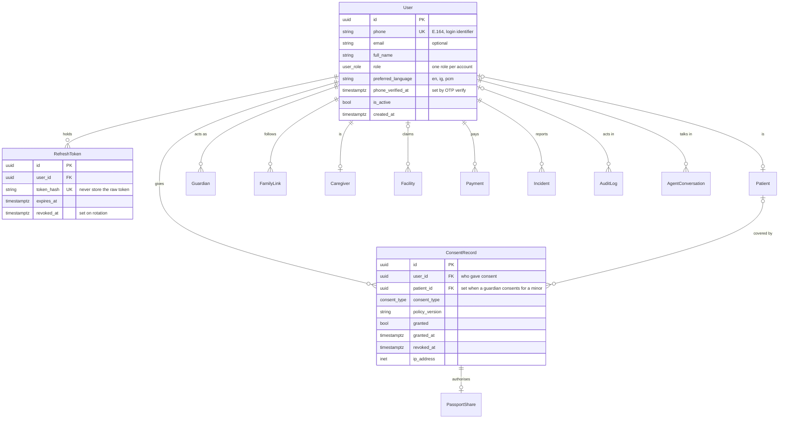

### 2.2 Patients

A patient may or may not have their own login: a minor's record is created and managed by a guardian (ON-3). The care profile is one-to-one with the patient and fully field-encrypted.

**Lives in** `app/domains/patients/models.py`. **Tables:** `Patient` → `patients`; `Guardian` → `guardians`; `EmergencyContact` → `emergency_contacts`; `CareProfile` → `care_profiles`; `FamilyLink` → `family_links` (P1)

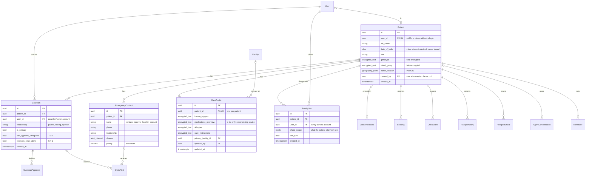

### 2.3 Caregivers

Layered vetting (TS-1): each verification step is its own row, two guarantors are required, and a human ops user approves the caregiver before they can be matched or booked.

**Lives in** `app/domains/caregivers/models.py`. **Tables:** `Caregiver` → `caregivers`; `Guarantor` → `guarantors`; `Certification` → `certifications`; `VerificationCheck` → `verification_checks`; `AvailabilityWindow` → `availability_windows`

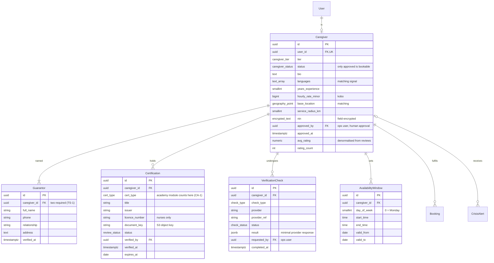

### 2.4 Facilities

Each SCD capability is a row in FacilityService, so the finder filters (FF-1) become simple joins. Location is a PostGIS point for distance search (FF-2).

**Lives in** `app/domains/facilities/models.py`. **Tables:** `Facility` → `facilities`; `FacilityService` → `facility_services`

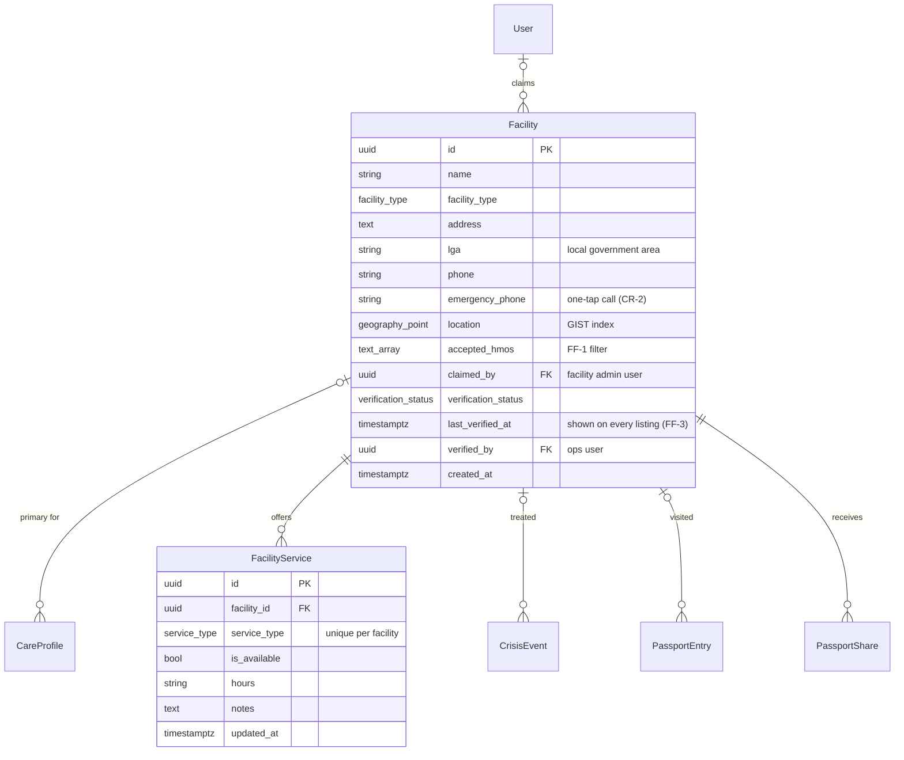

### 2.5 Bookings

One booking has one or more shifts (a live-in booking spans many). Check-ins hang off shifts, so GPS records stay correct for multi-day bookings.

**Lives in** `app/domains/bookings/models.py`. **Tables:** `Booking` → `bookings`; `GuardianApproval` → `guardian_approvals`; `Shift` → `shifts`; `CheckIn` → `check_ins`; `Review` → `reviews`; `CareNote` → `care_notes` (P1)

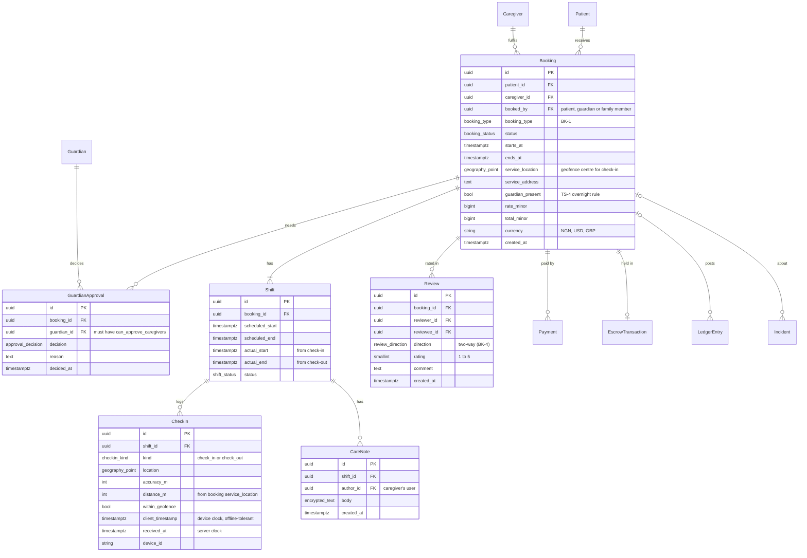

### 2.6 Payments and escrow

CareKin never holds funds: EscrowTransaction mirrors the partner's state, and every money movement posts balanced debit and credit rows to the ledger (BK-6).

**Lives in** `app/domains/payments/models.py (new domain)`. **Tables:** `Payment` → `payments` (starter repo); `EscrowTransaction` → `escrow_transactions`; `LedgerEntry` → `ledger_entries` (starter repo); `WebhookEvent` → `webhook_events` (starter repo)

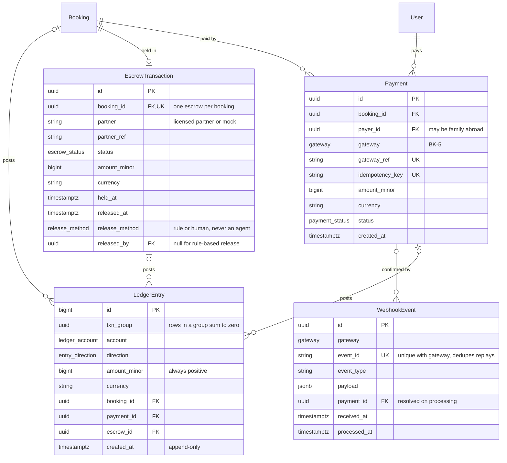

### 2.7 Crisis

A crisis event fans out to one alert per recipient, so each delivery can be retried and tracked (CR-1). client_event_id makes offline replays safe.

**Lives in** `app/domains/crisis/models.py`. **Tables:** `CrisisEvent` → `crisis_events`; `CrisisAlert` → `crisis_alerts`

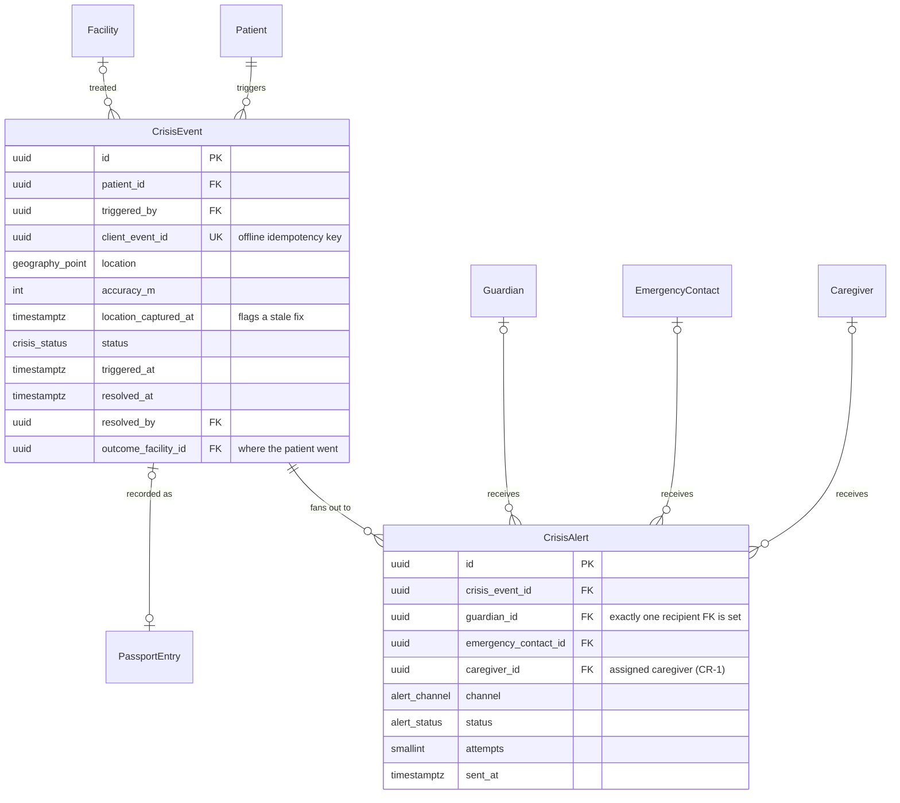

### 2.8 Health passport

Entries are encrypted (HP-4). A share to a facility can't exist without the consent record that authorises it (HP-3).

**Lives in** `app/domains/passport/models.py`. **Tables:** `PassportEntry` → `passport_entries`; `PassportShare` → `passport_shares`

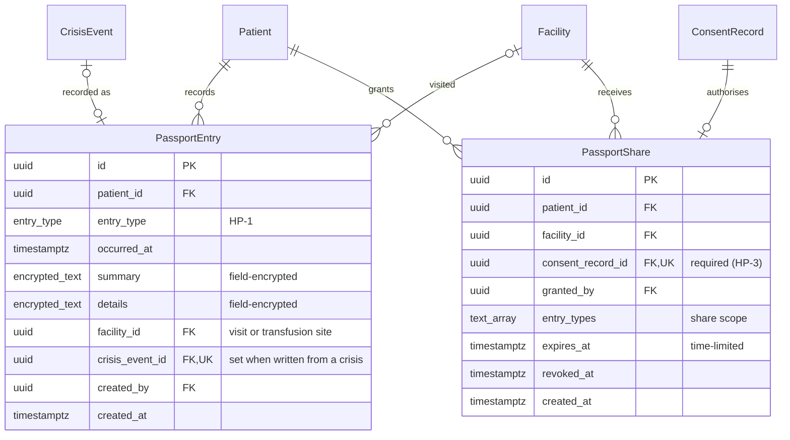

### 2.9 Trust and safety

Incidents can flag a dispute, which holds escrow (TS-5). The audit log is append-only and points at any entity by type and id.

**Lives in** `app/domains/trust/models.py; AuditLog in app/core/audit.py`. **Tables:** `Incident` → `incidents`; `AuditLog` → `audit_logs` (starter repo)

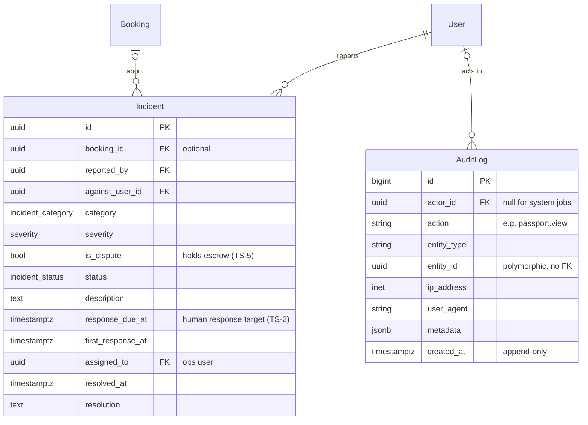

### 2.10 AI agents

Conversation logs and guardrail flags for both agents (PRD 8.1). Agents read and write through the API; these tables are written by the API, never by the agent directly.

**Lives in** `app/agents/models.py (new file)`. **Tables:** `AgentConversation` → `agent_conversations` (starter repo); `AgentMessage` → `agent_messages` (starter repo); `Reminder` → `reminders`

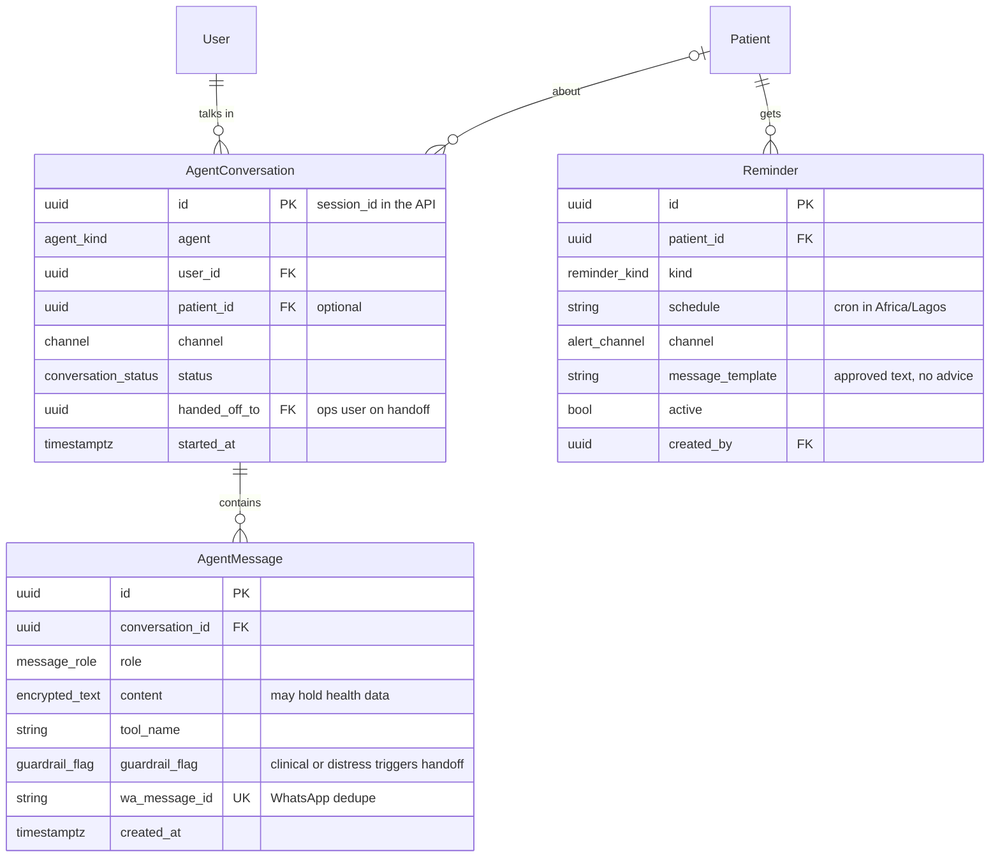

## 3. Migration order

A safe order for creating tables so every foreign key points at a table that already exists.

**Create all tables in one initial migration on Day 3**, as the build plan suggests, not domain by domain as endpoints are built. Table dependencies don't always follow endpoint order: `passport_entries` has a foreign key to `crisis_events`, but the passport endpoints come on Day 8 and crisis on Day 9. `audit_logs` only depends on `users`, so it can go straight after it; the build plan needs it from Day 2.

| # | Table | Domain | Depends on |
| --- | --- | --- | --- |
| 1 | `User` (`users`) | Auth and consent | None |
| 2 | `RefreshToken` (`refresh_tokens`) | Auth and consent | `User` |
| 3 | `Patient` (`patients`) | Patients | `User` |
| 4 | `ConsentRecord` (`consent_records`) | Auth and consent | `User`, `Patient` |
| 5 | `Guardian` (`guardians`) | Patients | `User`, `Patient` |
| 6 | `EmergencyContact` (`emergency_contacts`) | Patients | `Patient` |
| 7 | `FamilyLink` (`family_links`) | Patients | `User`, `Patient` |
| 8 | `Caregiver` (`caregivers`) | Caregivers | `User` |
| 9 | `Guarantor` (`guarantors`) | Caregivers | `Caregiver` |
| 10 | `Certification` (`certifications`) | Caregivers | `User`, `Caregiver` |
| 11 | `VerificationCheck` (`verification_checks`) | Caregivers | `User`, `Caregiver` |
| 12 | `AvailabilityWindow` (`availability_windows`) | Caregivers | `Caregiver` |
| 13 | `Facility` (`facilities`) | Facilities | `User` |
| 14 | `CareProfile` (`care_profiles`) | Patients | `User`, `Patient`, `Facility` |
| 15 | `FacilityService` (`facility_services`) | Facilities | `Facility` |
| 16 | `Booking` (`bookings`) | Bookings | `User`, `Patient`, `Caregiver` |
| 17 | `GuardianApproval` (`guardian_approvals`) | Bookings | `Guardian`, `Booking` |
| 18 | `Shift` (`shifts`) | Bookings | `Booking` |
| 19 | `CheckIn` (`check_ins`) | Bookings | `Shift` |
| 20 | `Review` (`reviews`) | Bookings | `User`, `Booking` |
| 21 | `CareNote` (`care_notes`) | Bookings | `User`, `Shift` |
| 22 | `Payment` (`payments`) | Payments and escrow | `User`, `Booking` |
| 23 | `EscrowTransaction` (`escrow_transactions`) | Payments and escrow | `User`, `Booking` |
| 24 | `LedgerEntry` (`ledger_entries`) | Payments and escrow | `Booking`, `Payment`, `EscrowTransaction` |
| 25 | `WebhookEvent` (`webhook_events`) | Payments and escrow | `Payment` |
| 26 | `CrisisEvent` (`crisis_events`) | Crisis | `User`, `Patient`, `Facility` |
| 27 | `CrisisAlert` (`crisis_alerts`) | Crisis | `Guardian`, `EmergencyContact`, `Caregiver`, `CrisisEvent` |
| 28 | `PassportEntry` (`passport_entries`) | Health passport | `User`, `Patient`, `Facility`, `CrisisEvent` |
| 29 | `PassportShare` (`passport_shares`) | Health passport | `User`, `Patient`, `ConsentRecord`, `Facility` |
| 30 | `Incident` (`incidents`) | Trust and safety | `User`, `Booking` |
| 31 | `AuditLog` (`audit_logs`) | Trust and safety | `User` |
| 32 | `AgentConversation` (`agent_conversations`) | AI agents | `User`, `Patient` |
| 33 | `AgentMessage` (`agent_messages`) | AI agents | `AgentConversation` |
| 34 | `Reminder` (`reminders`) | AI agents | `User`, `Patient` |

## 4. User references not drawn

These are real foreign keys to `users.id`, used for accountability and the audit trail. All are nullable unless the table notes say otherwise.

| Column | Purpose |
| --- | --- |
| `patients.created_by` | User who created the record (often a guardian) |
| `care_profiles.updated_by` | Last editor |
| `caregivers.approved_by` | Ops user who approved the caregiver |
| `certifications.verified_by` | Ops user who checked the document |
| `verification_checks.requested_by` | Ops user who triggered the check |
| `facilities.verified_by` | Ops user who verified the listing |
| `bookings.booked_by` | Patient, guardian or family member who booked |
| `reviews.reviewer_id` | Who wrote the review |
| `reviews.reviewee_id` | Who is being rated |
| `care_notes.author_id` | Caregiver's user account |
| `escrow_transactions.released_by` | Ops user for a manual release |
| `crisis_events.triggered_by` | Patient or guardian who pressed the button |
| `crisis_events.resolved_by` | Who closed the event |
| `passport_entries.created_by` | Author of the entry |
| `passport_shares.granted_by` | Patient or guardian who granted the share |
| `incidents.against_user_id` | User the report is about |
| `incidents.assigned_to` | Ops user handling it |
| `agent_conversations.handed_off_to` | Ops user who took over |
| `reminders.created_by` | Who set the reminder |

## 5. Enums

| Enum | Values |
| --- | --- |
| `user_role` | patient, guardian, family_abroad, caregiver, facility_admin, ops |
| `consent_type` | terms, health_data, location, passport_share, llm_processing |
| `caregiver_tier` | companion, trained_carer, licensed_nurse |
| `caregiver_status` | applied, verifying, verified, approved, suspended, rejected |
| `cert_type` | academy_module, nursing_licence, other |
| `review_status` | pending, verified, rejected |
| `check_type` | nin, background, guarantor, interview |
| `check_status` | requested, passed, failed, error |
| `facility_type` | teaching_hospital, general_hospital, private_hospital, clinic, lab, blood_bank |
| `verification_status` | unverified, pending, verified, stale |
| `service_type` | haematologist, emergency_24h, transfusion, blood_bank, genotype_testing |
| `booking_type` | hourly, daily, overnight, live_in |
| `booking_status` | requested, pending_guardian, accepted, declined, paid, in_progress, completed, cancelled, disputed |
| `approval_decision` | approved, rejected |
| `shift_status` | scheduled, in_progress, completed, missed |
| `checkin_kind` | check_in, check_out |
| `review_direction` | family_to_caregiver, caregiver_to_family |
| `gateway` | paystack, stripe |
| `payment_status` | initiated, succeeded, failed, refunded |
| `escrow_status` | pending, held, on_hold_dispute, released, refunded |
| `release_method` | rule, human |
| `ledger_account` | family_funds, escrow, caregiver_payable, platform_revenue, gateway_clearing |
| `entry_direction` | debit, credit |
| `crisis_status` | active, resolved, cancelled |
| `alert_channel` | sms, whatsapp, push |
| `alert_status` | queued, sent, delivered, failed |
| `entry_type` | crisis, trigger, visit, transfusion, medication |
| `incident_category` | safety, neglect, conduct, payment, other |
| `severity` | low, medium, high, critical |
| `incident_status` | open, investigating, resolved, dismissed |
| `agent_kind` | companion, matching |
| `channel` | whatsapp, web, mobile |
| `conversation_status` | active, handed_off, closed |
| `message_role` | user, assistant, tool, system |
| `guardrail_flag` | none, clinical, distress |
| `reminder_kind` | hydration, medication, appointment, check_in |

## 6. Constraints and indexes

- **Unique:** `users.phone`; `patients.user_id`; `care_profiles.patient_id`; `caregivers.user_id`; `guardians (patient_id, user_id)`; `facility_services (facility_id, service_type)`; `escrow_transactions.booking_id`; `payments.gateway_ref`; `payments.idempotency_key`; `webhook_events (gateway, event_id)`; `crisis_events.client_event_id`; `passport_entries.crisis_event_id`; `passport_shares.consent_record_id`; `reviews (booking_id, reviewer_id)`; `agent_messages.wa_message_id`.
- **GIST (spatial):** `facilities.location`, `caregivers.base_location`, `bookings.service_location`, `crisis_events.location`, `patients.home_location`.
- **Queue indexes:** partial indexes on `caregivers (status) WHERE status IN ('applied','verifying','verified')`, `facilities (verification_status) WHERE verification_status <> 'verified'` and `incidents (response_due_at) WHERE status IN ('open','investigating')`.
- **Lookup indexes:** every FK column, plus `bookings (caregiver_id, starts_at)` for availability clashes and `audit_logs (entity_type, entity_id)`.
- **Checks:** `reviews.rating BETWEEN 1 AND 5`; `availability_windows.start_time < end_time`; `bookings.starts_at < ends_at`; `crisis_alerts` has exactly one of `guardian_id`, `emergency_contact_id`, `caregiver_id` set; `ledger_entries.amount_minor > 0`.
- **Ledger balance:** for each `txn_group`, debits equal credits. Enforce in the payments service and test it in `test_bookings.py`; a deferred constraint trigger is an option later.
- **Append-only:** revoke `UPDATE` and `DELETE` on `audit_logs` and `ledger_entries` for the application role.
- **Deletes:** health data is never hard-deleted by cascade. Use `ON DELETE RESTRICT` on FKs to `patients`, and handle account deletion as an explicit NDPA process.

## 7. How the schema enforces PRD rules

| Rule | Where it lives in the schema |
| --- | --- |
| ON-2 consent before health data | `consent_records`; the API refuses to write `care_profiles`, `passport_entries` or `patients.genotype` without a granted `health_data` consent. |
| ON-3 profiles for minors | `patients.user_id` is nullable and `date_of_birth` drives minor checks; `guardians` links adults to the record. |
| TS-1 layered vetting | `guarantors` (two required), `verification_checks` per check, `certifications`, and `caregivers.status` only reaching `approved` via a human (`approved_by`). |
| TS-3 guardian approves caregivers for minors | `bookings.status = pending_guardian` until a `guardian_approvals` row with `decision = approved` from a guardian with `can_approve_caregivers`. |
| TS-4 no overnight without a guardian in month one | Checked on booking creation using `bookings.booking_type`, `guardian_present` and the date of the first completed booking between that caregiver and patient. |
| BK-2 escrow released by rule or human | `escrow_transactions.release_method` is `rule` or `human`; there's no agent value. `released_by` records the human. |
| BK-3 offline-tolerant GPS check-in | `check_ins.client_timestamp` and `received_at`, with `within_geofence` computed against `bookings.service_location`. |
| BK-6 double-entry, idempotent webhooks | `ledger_entries` grouped by `txn_group`; unique `webhook_events (gateway, event_id)` and `payments.idempotency_key`. |
| TS-5 escrow held during a dispute | `incidents.is_dispute` moves the booking to `disputed` and the escrow to `on_hold_dispute`; release refuses in that state. |
| CR-1 alert contacts and caregiver | `crisis_alerts`, one row per guardian, emergency contact or assigned caregiver, each with its own delivery status. |
| CR-4 crisis feeds the passport | `passport_entries.crisis_event_id`, written with consent when the crisis is resolved. |
| FF-1 to FF-3 facility finder | `facility_services` rows for each filter, `facilities.accepted_hmos`, `facilities.location`, `facilities.last_verified_at`. |
| HP-3 every share consented | `passport_shares.consent_record_id` is NOT NULL and unique; revoking sets `revoked_at`. |
| HP-4 encryption and view logging | `encrypted_text` columns; every passport read writes an `audit_logs` row with `action = passport.view`. |
| PRD 8.1 agent logs and handoff | `agent_messages.guardrail_flag`; a `clinical` or `distress` flag sets `agent_conversations.status = handed_off`. |

## 8. Open decisions that change the schema

- **Caregiver tiers (Topic 2).** `caregiver_tier` uses the PRD's three tiers. If the team renames them or adds criteria, change the enum before the first migration.
- **Escrow release rules (Topic 3).** Partial releases or an auto-release timeout would need `escrow_transactions.amount_released_minor` and `auto_release_at`.
- **Caregiver access to the passport (Topic 4).** If a caregiver gets read access on booking acceptance, add a grantee to `passport_shares` (facility or caregiver) rather than a new table.
- **One role per user.** `users.role` holds one role. A guardian who is also a patient would need two accounts. If that's common in interviews, switch to a `user_roles` join table now; it's costly to change later.
- **Family-abroad role (ON-5).** The kickoff's role letters use F for Facility. The enum value here is `family_abroad`.
- **Starter repo.** If the shared starter repo already defines users, payments, audit or agent tables, align column names to it and drop the duplicates here.